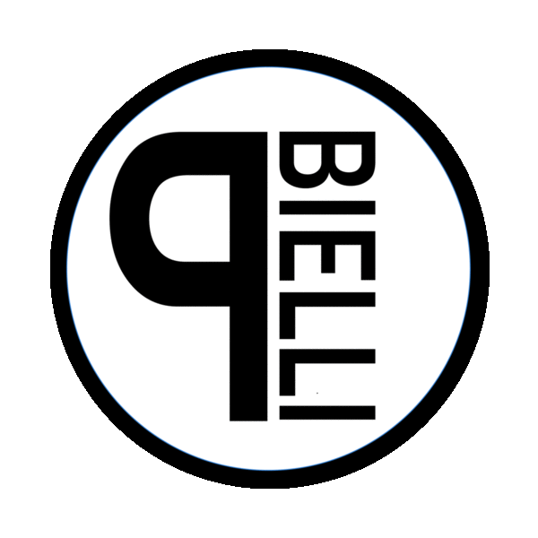

# utils

Shared assets of pBielli and the Hive suite (logos, animations). Raw URL pattern:
<pre>
https://raw.githubusercontent.com/pBielli/utils/main/imgs/FOLDER/FILE
</pre>

## Logos

| pBielli (original) | pBielli — Hive style, light | pBielli — Hive style, dark |
|:---:|:---:|:---:|
|  |  |  |
| `logos/pBielli.svg` · `.png` · `pBielli_PNG.png` | `logos/pBielli_hive_light.svg` · `.png` | `logos/pBielli_hive_dark.svg` · `.png` |

Hive style = the minimal original (ring, mirrored **P**, vertical **BIELLI**) with the ring drawn as the Hive hexagon and a
Hive-amber hairline. Colours: amber `#F5B301`, deep amber `#C98A00`, ink `#0B1220`, paper `#F8FAFC`.

## Animations

| pBielli loading (original) | pBielli — Hive loading | pBielli — Hive spinner |
|:---:|:---:|:---:|
|  |  |  |
| `anim/pBielli_loading.gif` | `anim/pBielli_hive_loading.gif` — hexagon draws, amber line, then the mark | `anim/pBielli_hive_spin.gif` — amber segment runs around the hexagon |

## Author tag

`author/` — the same author identity in every app:

| file | use |
|---|---|
| `author/author.json` | name, URL (pbielli.com), GitHub, copyright, logo URLs — read by apps for "by pBielli" links |
| `author/pbielli-{32,64,128,256}.png` | logo bitmaps (Hive style, light) |
| `author/inno/author.iss` + `pbielli-small-{55,110}.bmp` | Inno Setup include: publisher, URLs, copyright and the small corner logo |

The app keeps its own logo as the main picture; the author logo stays small in the corner.

## pbuild

`pbuild/` — `pbuild owner/repo` builds any app from its `build.json` on Windows (tools via winget, steps, artifacts). See `pbuild/README.md`.
