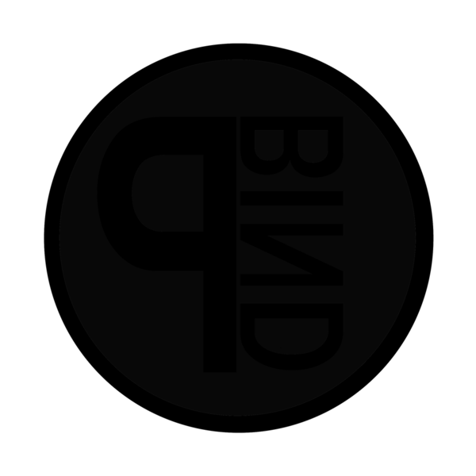
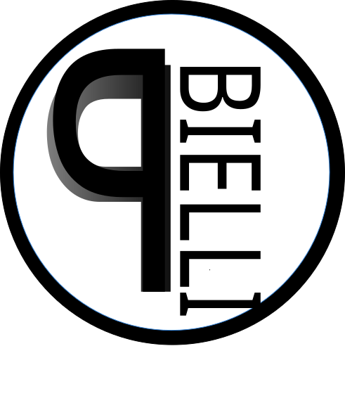

# utils

# imgs
<pre>
https://raw.githubusercontent.com/pBielli/utils/main/imgs/FOLDER/FILE
</pre>

## anim
pBielli_loading.gif             |  pBind_light.gif
:-------------------------:|:-------------------------:
  |  

## logos
pBielli.svg             |  pBind.svg             |  pBind_circular.svg
:-------------------------:|:-------------------------:|:-------------------------:
  |    |  

## Logos

| File | What |
|---|---|
| `imgs/logos/pBielli.svg` / `.png` | pBielli logo (original, round) |
| `imgs/logos/pBielli_hive_light.svg` / `.png` | pBielli logo in the Hive style (hexagon, Hive amber), light |
| `imgs/logos/pBielli_hive_dark.svg` / `.png` | same, dark background |
